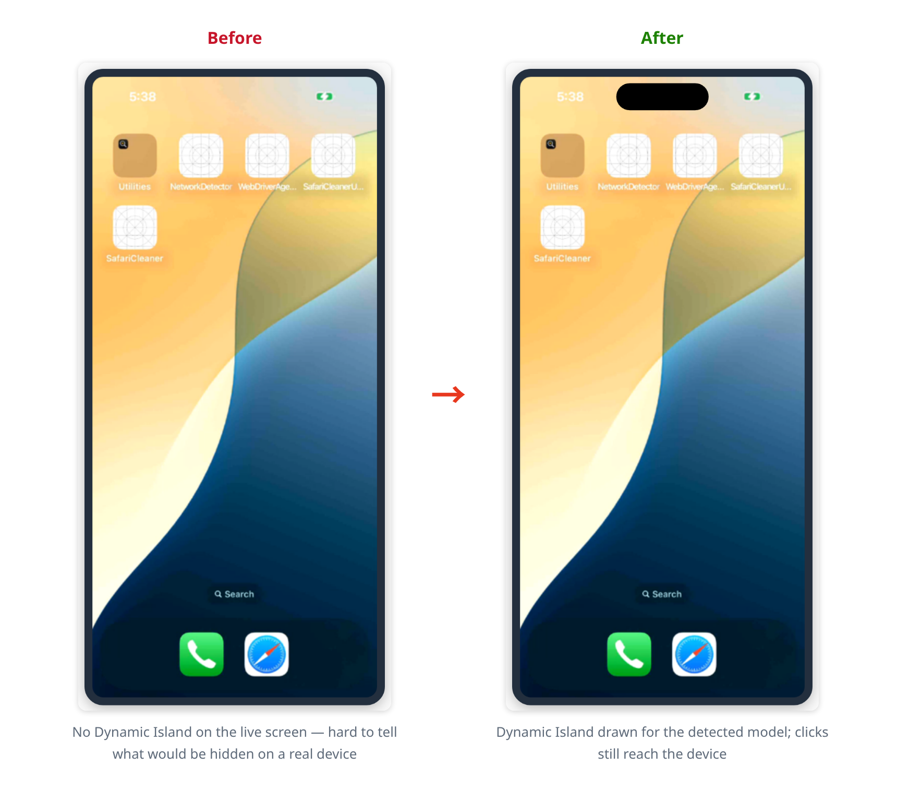
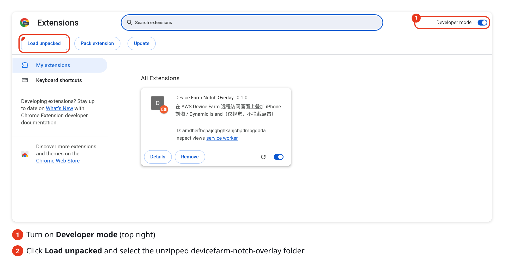
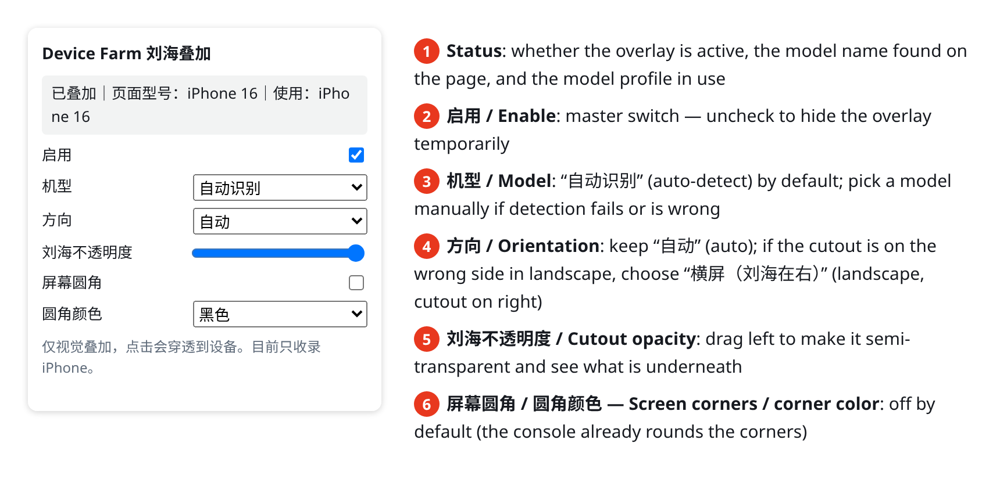
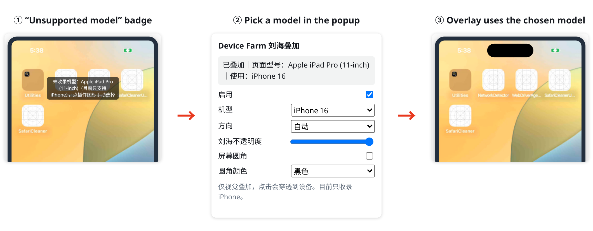
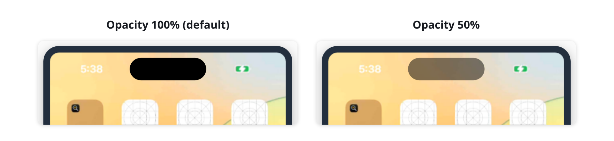
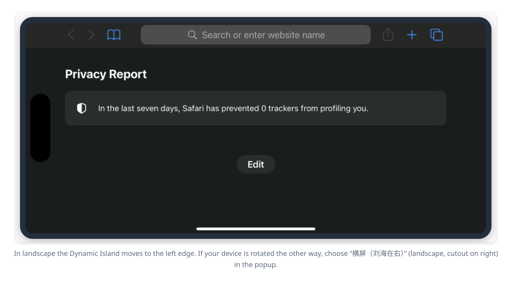

# Device Farm Notch Overlay

**English** | [简体中文](README.zh-CN.md)

A Chrome / Edge extension that draws the iPhone **notch / Dynamic Island** on top of the live screen of an [AWS Device Farm](https://aws.amazon.com/device-farm/) remote access session.



## Why

The Device Farm live screen shows the device's screen frames, which are rectangular images. The notch and the Dynamic Island are physical parts of the phone that cover the display. They are not pixels, so they never appear in screenshots, screen recordings, or the remote live view. The console does draw a phone frame and rounded corners, but no notch. During remote testing, that makes it hard to tell whether a button or a line of text would be hidden on a real device.

This extension draws the notch / Dynamic Island back onto the live screen, sized for the device model, so you can check this by eye.

- **Visual only.** Clicks, drags, and keyboard input still reach the device. The overlay does not show up in Device Farm screenshots or recordings.
- **No data collection.** The extension only requests the `storage` permission (to save your settings). It only runs on `https://us-west-2.console.aws.amazon.com/devicefarm/*` and makes no network requests.

> **Note:** The extension's popup and on-screen messages are currently in Chinese. The screenshots in this guide show each Chinese label next to its English meaning.

---

## Quick start (5 minutes)

### Step 1: Download the extension

1. Open the [Releases](../../releases) page and download `devicefarm-notch-overlay-vX.Y.Z.zip` from the latest release.
   - If that zip isn't listed, download **Source code (zip)** instead, unzip it, and use the `extension` folder inside it.
2. Unzip it somewhere you **won't delete later**, for example `Documents/devicefarm-notch-overlay`.

   > Chrome loads the extension from this folder every time it starts. If you delete or move the folder, the extension stops working.

3. Open the folder and check that it contains `manifest.json`:

   ```
   devicefarm-notch-overlay/
   ├── manifest.json      ← you're in the right folder
   ├── content.js
   ├── devices.js
   ├── popup.html
   └── ...
   ```

### Step 2: Add it to Chrome

1. Type `chrome://extensions` in the address bar and press Enter (in Edge, use `edge://extensions`).
2. Turn on **Developer mode** (top right).
3. Click **Load unpacked**, which now appears at the top left.
4. Select the folder from Step 1 (the one that contains `manifest.json`), then click **Select**.
5. When a **Device Farm Notch Overlay** card appears in the list, the extension is installed.



6. (Recommended) Click the puzzle icon 🧩 at the top right of the browser, find Device Farm Notch Overlay, and click the pin 📌 next to it. This keeps the extension icon on the toolbar so you can open its settings quickly.

> If Chrome shows a "Disable developer mode extensions" prompt at startup, close the prompt with ✕. **Don't** click "Disable".

### Step 3: Open a remote session

1. Start an iPhone remote access session in the Device Farm console (**us-west-2** region), as you normally would.
2. Once the device screen appears, the notch / Dynamic Island is drawn at the top **automatically**. No setup is needed.

   

3. If it doesn't appear, refresh the session page with `F5`.

You're done. Everything below is optional.

---

## Settings (optional)

Click the extension icon on the toolbar to open the settings popup. Changes apply **immediately**; you don't need to reload the page.



### Common situations

**1. The screen shows "未收录机型" (unsupported model)**

The extension didn't recognize the device (for example an iPad, an Android device, or a very new model). In the popup, pick the closest iPhone under **机型 (Model)**. The choice only applies to the current tab.



**2. You want to see what the notch is covering**

Drag the **刘海不透明度 (Cutout opacity)** slider to the left to make the notch semi-transparent.



**3. In landscape, the notch is on the wrong side**

In landscape, the extension draws the notch on the left by default. If the device is rotated the other way, set **方向 (Orientation)** to **横屏（刘海在右）(landscape, cutout on right)**. Set it back to **自动 (auto)** when you're done.



**4. In landscape, the screen shows "横屏：控制台把横屏画面裁成竖屏框" (landscape cropped into a portrait frame)**

This is how the console itself displays the session in this case: it crops the landscape image into the portrait frame, so the edge where the notch would be is not visible. The extension doesn't draw the notch then. This is expected.

**5. You want to hide the notch for a while**

Uncheck **启用 (Enable)**. Check it again to bring the notch back.

### All options

| Option (popup label) | Default | Description |
|---|---|---|
| 启用 — Enable | On | Master switch |
| 机型 — Model | 自动识别 (auto-detect) | Detected from the device name on the page. If detection fails or picks the wrong model, choose one manually (applies to the current tab only) |
| 方向 — Orientation | 自动 (auto) | Auto / 强制竖屏 (force portrait) / 横屏（刘海在左）(landscape, cutout on left) / 横屏（刘海在右）(landscape, cutout on right) |
| 刘海不透明度 — Cutout opacity | 100% | Lower it to make the notch semi-transparent |
| 屏幕圆角 — Screen corners | Off | The console already rounds the corners. Turn this on to mask the corners with the real device's corner radius |
| 圆角颜色 — Corner color | 黑色 (black) | Black, or the console's frame color |

---

## FAQ

**I installed it, but nothing appears on the session page.**
- Make sure the session is in **us-west-2**: the URL starts with `https://us-west-2.console.aws.amazon.com/devicefarm/`.
- In `chrome://extensions`, make sure the toggle at the bottom right of the extension card is on.
- Refresh the session page with `F5`.
- Open the popup and check the status line at the top. If it says "当前页面未注入" (not active on this page), the current tab is not a Device Farm session page.

**How do I update to a new version?**
Download and unzip the new version over the old folder. Then, in `chrome://extensions`, click the reload button ↻ on the extension card.

**How do I uninstall it?**
In `chrome://extensions`, click **Remove** on the extension card.

**Does it affect my clicks on the live screen?**
No. The overlay ignores all mouse events, so clicks on the notch area still go to the device.

---

## Supported devices (iPhone only for now)

| Type | Models |
|---|---|
| Dynamic Island | 14 Pro / 14 Pro Max, 15 series, 16 series, 17 series, iPhone Air, 18 Pro / 18 Pro Max |
| Notch | X / XS / XS Max / XR, 11 series, 12 series, 13 series, 14 / 14 Plus, 16e |
| No notch | SE (2nd/3rd gen), 8, 7, 6s |

iPhone models that aren't in the table yet (number 18 or later) fall back to the 18 Pro or 18 Pro Max profile, depending on screen size. Android devices are not supported yet.

## Limitations

- Notch and Dynamic Island sizes are approximations based on public sources and real-device screenshots, accurate to about 1–3 pt. iPhone 16 has been calibrated against a real Device Farm session.
- The iPhone 18 Pro models have a smaller Dynamic Island. Apple hasn't published its size, so the current width is estimated from published hands-on measurements.
- Some full-screen content (for example a portrait video with black bars at the top and bottom) can be mistaken for a cropped landscape screen. If that happens, set **方向 (Orientation)** to **强制竖屏 (force portrait)**.
- The extension depends on the structure of the Device Farm console page. If the console is redesigned, the extension may need an update (it falls back to finding the device screen by its shape).

## Development and testing

The extension needs no build step. The repo includes a local mock session page, so you can run a regression test with Playwright without an AWS account:

```bash
npm install
npx playwright install chromium
npm test                    # regression test; screenshots go to test-output/
npm run docs:screenshots    # regenerate README screenshots into docs/images/{en,zh}/ (needs a CJK font installed)
```

The README screenshots are produced by `test/make-docs-screenshots.cjs`. The device screen images come from real device screenshots, the console page is the mock page, and the extension is actually loaded and running.

Device profiles live in `extension/devices.js` (portrait logical coordinates, in pt). Issues and PRs that add or calibrate models are welcome.

## License

[MIT](LICENSE)

This project is not an official AWS product and is not affiliated with Amazon Web Services or Apple.
