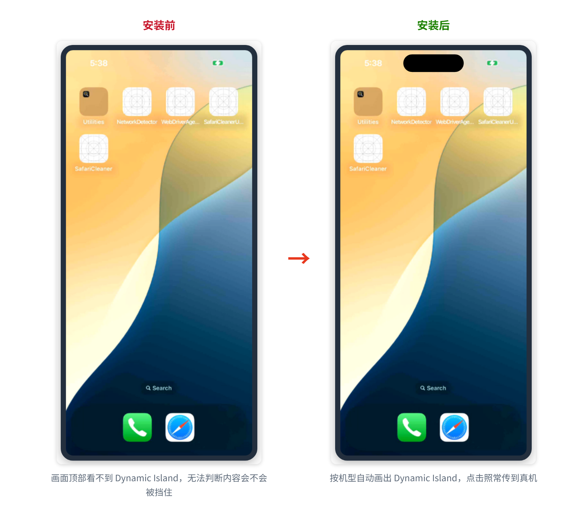
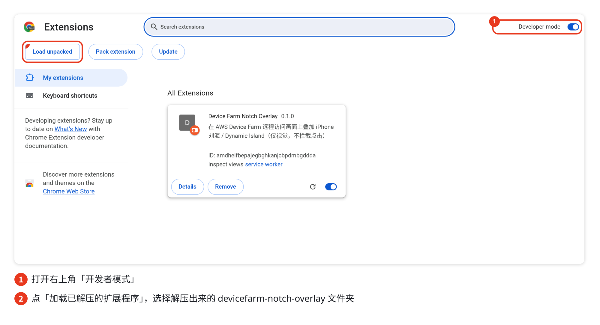
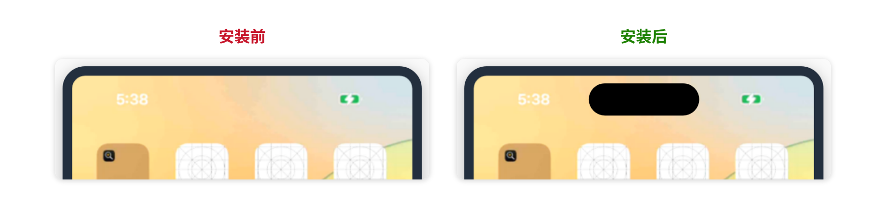
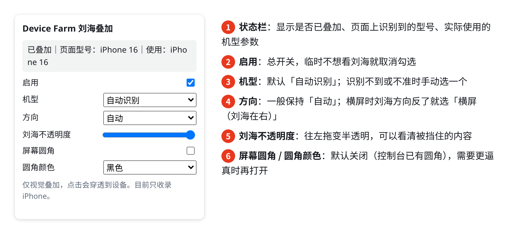
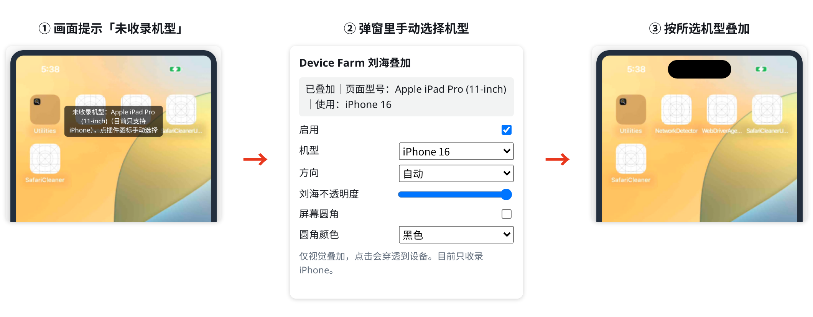
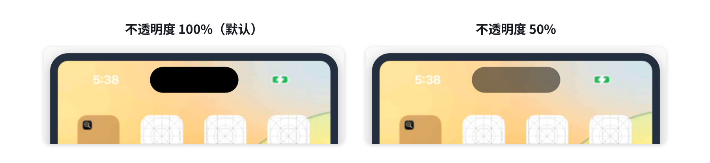
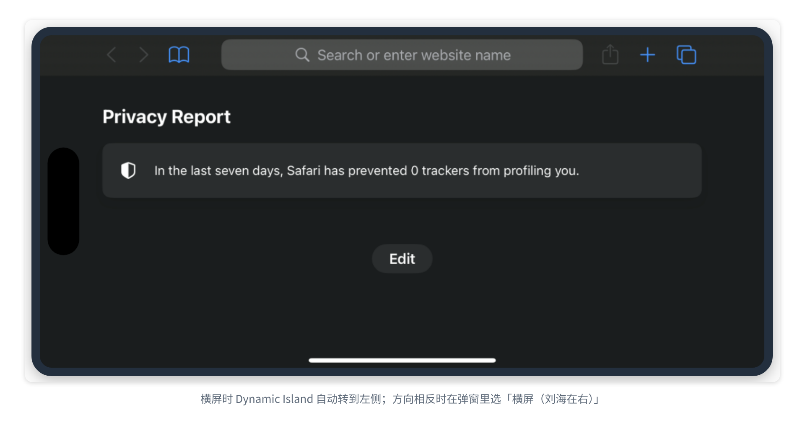

# Device Farm Notch Overlay

一个 Chrome / Edge 浏览器插件：在 [AWS Device Farm](https://aws.amazon.com/device-farm/) 远程访问会话的实时画面上，叠加画出 iPhone 的**刘海 / Dynamic Island**。



## 为什么需要它

Device Farm 远程画面是设备的屏幕帧（矩形图像）。刘海和 Dynamic Island 是屏幕上的物理遮挡，不是像素，所以系统截图、录屏和远程画面里都看不到它们。控制台画了手机外框和屏幕圆角，但没有刘海。这样在远程调试时，很难判断某个按钮或文字在真机上会不会被挡住。

这个插件按机型把刘海 / 岛画回画面上，方便目测。

- **只是视觉叠加**：点击、拖动、键盘输入都会照常传到真机。叠加内容不会出现在 Device Farm 的截图和录像里。
- **不收集数据**：只申请 `storage` 权限（保存你的设置），只在 `https://us-west-2.console.aws.amazon.com/devicefarm/*` 页面运行，不发任何网络请求。

---

## 5 分钟上手

### 第 1 步：下载插件

1. 打开本仓库的 [Releases](../../releases) 页面，在最新版本下面下载 `devicefarm-notch-overlay-vX.Y.Z.zip`。
   - 没看到这个 zip 的话，下载 **Source code (zip)** 也可以，解压后使用里面的 `extension` 文件夹。
2. 解压到一个**以后不会删掉**的位置，例如 `文档/devicefarm-notch-overlay`。

   > Chrome 每次启动都会从这个文件夹加载插件，删掉或移动文件夹后插件就失效了。

3. 打开文件夹确认一下，里面应该能看到 `manifest.json`：

   ```
   devicefarm-notch-overlay/
   ├── manifest.json      ← 看到它就对了
   ├── content.js
   ├── devices.js
   ├── popup.html
   └── ...
   ```

### 第 2 步：装进 Chrome

1. 在 Chrome 地址栏输入 `chrome://extensions` 并回车（Edge 输入 `edge://extensions`）。
2. 打开右上角的 **开发者模式（Developer mode）** 开关。
3. 点左上角出现的 **加载已解压的扩展程序（Load unpacked）**。
4. 选择第 1 步解压出来的文件夹（就是有 `manifest.json` 的那一层），点「选择」。
5. 列表里出现 **Device Farm Notch Overlay** 卡片，就说明装好了。



6. （推荐）点浏览器右上角的拼图图标 🧩，找到 Device Farm Notch Overlay，点旁边的图钉 📌，把它固定到工具栏，之后调设置更方便。

> 如果 Chrome 启动时提示「请停用以开发者模式运行的扩展程序」，点 ✕ 关掉提示即可，**不要**点「停用」。

### 第 3 步：打开远程会话，直接看效果

1. 照常在 Device Farm 控制台（**us-west-2 区域**）开启一个 iPhone 远程访问会话。
2. 等设备画面出现，刘海 / Dynamic Island 会**自动**画在画面顶部，不需要任何配置。

   

3. 没出现的话，按 `F5` 刷新一下会话页面。

到这里就可以正常使用了。下面的配置都是可选的。

---

## 按需配置

点工具栏上的插件图标，打开设置弹窗。改动**立即生效**，不需要刷新页面。



### 常见场景

**场景 1：画面上提示「未收录机型」**

插件没认出当前设备（比如 iPad、Android，或者特别新的机型）。在弹窗的「机型」里手动选一个最接近的 iPhone 就行，只对当前标签页生效。



**场景 2：想看清刘海下面挡住了什么**

把「刘海不透明度」滑块往左拖，刘海会变成半透明。



**场景 3：横屏时刘海在错误的一边**

插件在横屏时默认把刘海画在左侧。如果设备实际转向相反，在「方向」里选 **横屏（刘海在右）**。用完改回「自动」。



**场景 4：横屏时画面上提示「控制台把横屏画面裁成竖屏框」**

这是控制台本身的显示方式：它把横屏画面裁进了竖向画框，刘海所在的那一边不在可见区域里，所以插件不画。属于正常现象。

**场景 5：临时不想看刘海**

取消勾选「启用」即可，再勾上就恢复。

### 选项一览

| 选项 | 默认值 | 说明 |
|---|---|---|
| 启用 | 开 | 总开关 |
| 机型 | 自动识别 | 根据页面上的设备名自动识别；识别不到或不准时手动选择（只对当前标签页生效） |
| 方向 | 自动 | 自动 / 强制竖屏 / 横屏（刘海在左）/ 横屏（刘海在右） |
| 刘海不透明度 | 100% | 调低后刘海变半透明 |
| 屏幕圆角 | 关 | 控制台已自带圆角；打开后按真机圆角遮住四角 |
| 圆角颜色 | 黑色 | 黑色或控制台外框色 |

---

## 常见问题

**装好了但会话页面上什么都没有？**
- 确认会话在 **us-west-2** 区域，地址以 `https://us-west-2.console.aws.amazon.com/devicefarm/` 开头。
- 确认 `chrome://extensions` 里插件卡片右下角的开关是打开的。
- 按 `F5` 刷新会话页面。
- 打开插件弹窗看顶部的状态栏：如果显示「当前页面未注入」，说明当前页面不是 Device Farm 会话页。

**怎么升级到新版本？**
下载新版 zip，解压后覆盖原文件夹，再到 `chrome://extensions` 点插件卡片上的刷新按钮 ↻。

**怎么卸载？**
在 `chrome://extensions` 里点插件卡片上的「移除（Remove）」。

**会影响我在画面上的点击吗？**
不会。叠加层不接收任何鼠标事件，点到刘海的位置也会照常传给设备。

---

## 支持的机型（目前只支持 iPhone）

| 类型 | 机型 |
|---|---|
| Dynamic Island | 14 Pro / 14 Pro Max、15 系列、16 系列、17 系列、iPhone Air、18 Pro / 18 Pro Max |
| 刘海 | X / XS / XS Max / XR、11 系列、12 系列、13 系列、14 / 14 Plus、16e |
| 无刘海 | SE（2/3 代）、8、7、6s |

表里没有的新款 iPhone（编号 ≥ 18）会按尺寸档位套用 18 Pro / 18 Pro Max 的参数。Android 设备目前不支持。

## 局限

- 刘海 / 岛的尺寸是根据公开资料和实机截图得出的近似值，误差约 1–3pt。iPhone 16 已对照真机画面校准。
- iPhone 18 Pro 系列的岛更小，Apple 没有公布尺寸，目前的宽度是按公开实拍测量估算的。
- 有些全屏内容（例如上下留黑边的竖屏视频）可能被误判成「被裁剪的横屏」，这时可以在「方向」里选「强制竖屏」。
- 插件依赖 Device Farm 控制台页面的结构。控制台改版后可能需要更新插件（插件内置了按画面形状自动识别的兜底逻辑）。

## 开发与测试

插件本身不需要构建。仓库里有一个本地模拟会话页，可以用 Playwright 加载插件做回归测试，不需要 AWS 账号：

```bash
npm install
npx playwright install chromium
npm test                    # 回归测试，截图输出到 test-output/
npm run docs:screenshots    # 重新生成 README 截图到 docs/images/（需要系统装有中文字体）
```

README 中的截图由 `test/make-docs-screenshots.cjs` 生成：设备画面来自真机截图，控制台页面是模拟页，插件是真实加载运行的。

机型参数在 `extension/devices.js`（竖屏逻辑坐标，单位 pt）。欢迎提 Issue / PR 补充或校准机型。

## License

[MIT](LICENSE)

本项目不是 AWS 官方产品，与 Amazon Web Services 和 Apple 无隶属关系。
